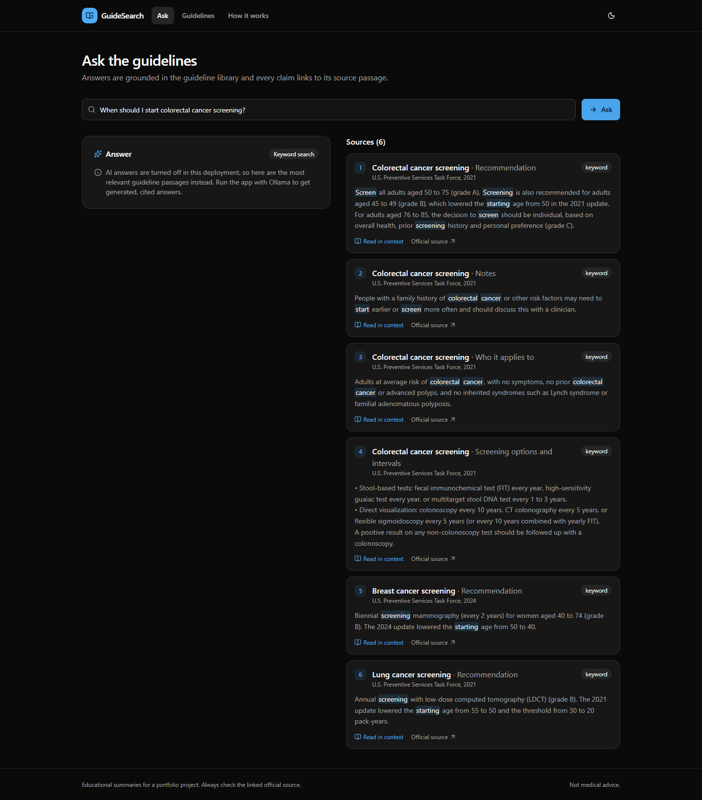
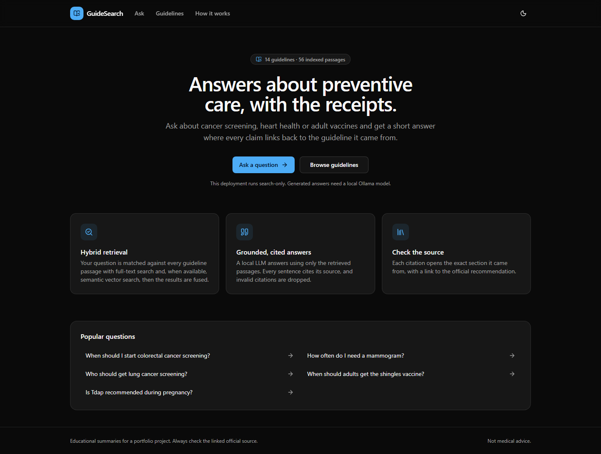
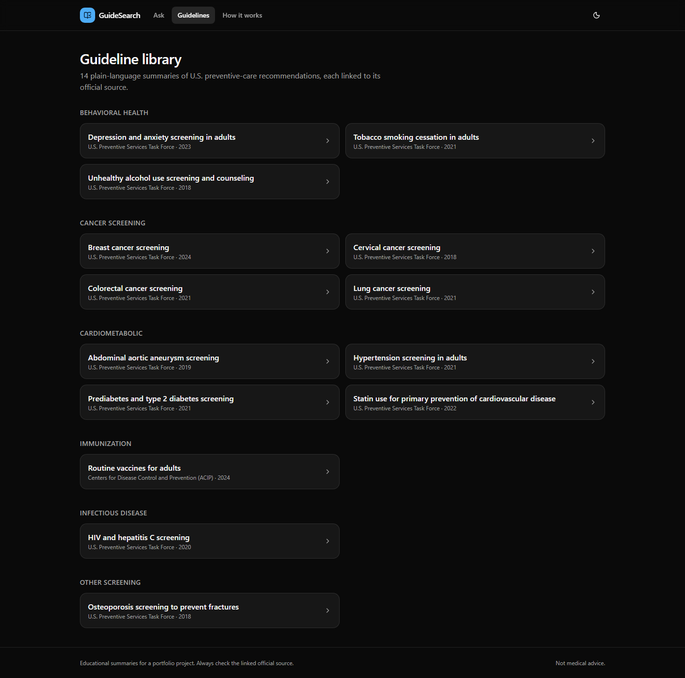
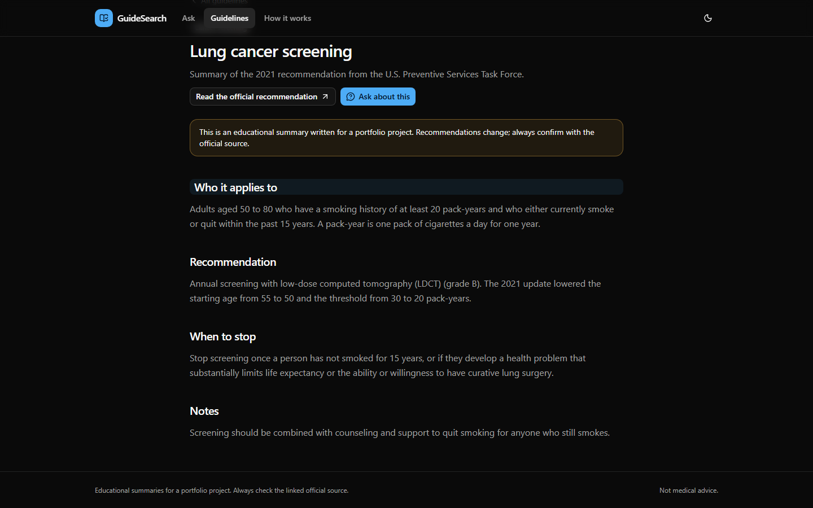
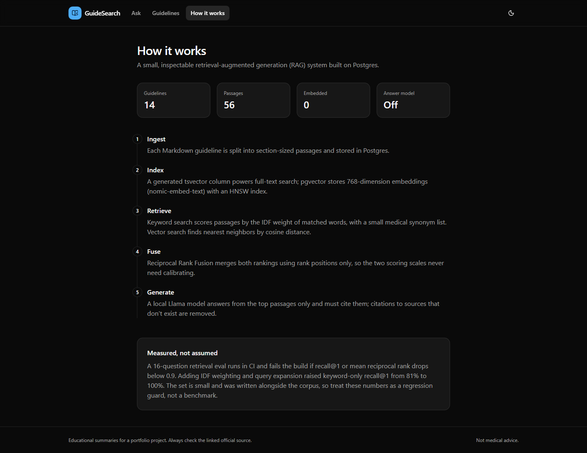

# GuideSearch: Cited Answers from Preventive-Care Guidelines

[](https://github.com/Mdjamilh/guideline-rag-search/actions/workflows/ci.yml)


A small, inspectable **retrieval-augmented generation (RAG)** system. Ask about cancer screening, heart health or adult vaccines and get a short answer in which every sentence cites the guideline passage it came from. Retrieval combines Postgres full-text search and pgvector, answers come from a local model via Ollama, and a retrieval eval runs in CI.

**Live demo:** https://guideline-rag-search.vercel.app (search-only mode: retrieval works, generated answers need Ollama)

> The 14 guideline summaries are written in plain language for this project, each linked to its official USPSTF or CDC page. Recommendations change, so check the source. Not medical advice.



## Features

- **Hybrid retrieval.** IDF-weighted full-text search plus pgvector cosine similarity, merged with Reciprocal Rank Fusion
- **Grounded, streamed answers.** A local Llama model answers only from the retrieved passages, and text streams in as it's generated
- **Verified citations.** Each `[n]` becomes a link to source *n*; citations to sources that don't exist are dropped before rendering
- **"Read in context."** Every source opens the exact guideline section it came from, next to a link to the official recommendation
- **Knows when to stay quiet.** If nothing relevant is retrieved, the model isn't called; weak vector matches are cut off by a distance threshold
- **Degrades gracefully.** Without Ollama (or if it's down), the app runs keyword-only search and shows the best passages
- **Shareable questions.** `/ask?q=...` URLs re-run the question

| | |
|---|---|
|  |  |
|  |  |

## How it works

```
question ─► expand synonyms ─► full-text search (IDF-weighted) ─┐
        └─► embed (nomic-embed-text) ─► pgvector HNSW search ───┴─► RRF fusion ─► top 6 passages
                                                                                     │
                     stream: {sources} → {delta}… → {done}  ◄── Llama via Ollama ◄───┘
```

Details are in [docs/ARCHITECTURE.md](docs/ARCHITECTURE.md).

## Retrieval quality

`npm run eval` runs a 16-question set (question → expected guideline) against a fresh database and reports recall@k and MRR. CI fails if recall@1 or MRR drops below 0.9.

| Keyword-only retrieval | recall@1 | recall@3 | MRR |
|---|---|---|---|
| Postgres `ts_rank_cd` (baseline) | 81.3% | 100% | 0.896 |
| + IDF weighting and synonym expansion | **100%** | **100%** | **1.000** |

The eval set is small and was written alongside the corpus, so treat it as a regression guard rather than a benchmark. A larger, independently written question set is on the roadmap.

## Tech stack

| Layer | Choice |
|---|---|
| Framework | Next.js 15 (App Router, Server Components, streaming Route Handler) |
| Language | TypeScript (strict) |
| Retrieval | PostgreSQL full-text search (generated `tsvector`, GIN) and pgvector (HNSW, cosine), Reciprocal Rank Fusion |
| Models | Ollama: `nomic-embed-text` (768-d embeddings), `llama3.1` (answers) |
| Database | Drizzle ORM; embedded PGlite with the pgvector extension when no `DATABASE_URL` is set |
| UI | Tailwind CSS v4, shadcn/ui, react-markdown, dark-first theme |
| Testing | Vitest (unit and integration on real Postgres with pgvector), Playwright (desktop and mobile, against a mock Ollama server) |
| CI | GitHub Actions: lint, typecheck, unit tests, retrieval eval, build, e2e |

## Getting started

Requires Node.js 20 or newer.

```bash
git clone https://github.com/Mdjamilh/guideline-rag-search.git
cd guideline-rag-search
npm install
npm run dev          # search-only mode, no other setup needed
```

To get generated answers, install [Ollama](https://ollama.com), then:

```bash
ollama pull nomic-embed-text
ollama pull llama3.1
OLLAMA_BASE_URL=http://localhost:11434 npm run dev
```

On first start the app migrates its embedded database and ingests `content/guidelines`, embedding passages when Ollama is reachable. Delete `.pglite/` to re-ingest.

### Environment variables

| Variable | Purpose |
|---|---|
| `OLLAMA_BASE_URL` | Ollama server. Enables vector search and generated answers. |
| `OLLAMA_CHAT_MODEL` / `OLLAMA_EMBED_MODEL` | Default `llama3.1` and `nomic-embed-text` |
| `DATABASE_URL` | Postgres with pgvector (for example Neon). Run `npm run db:migrate && npm run ingest`. |
| `VECTOR_MAX_DISTANCE` | Cosine-distance cutoff for semantic matches. Default 0.55. |
| `ASK_RATE_LIMIT` | Questions per IP per minute. Default 20. |

## Scripts

| Command | What it does |
|---|---|
| `npm run dev` / `npm run build` / `npm start` | Next.js |
| `npm test` | Vitest: chunking, RRF, citations, Ollama client, ingestion, retrieval, answer pipeline |
| `npm run eval` | Retrieval eval with recall@1/3/5 and MRR |
| `npm run test:e2e` | Playwright against a production build and the mock Ollama server |
| `npm run ingest` | (Re)ingest the corpus into `DATABASE_URL` |
| `npm run screenshots` | Re-capture README screenshots |

## Adding a guideline

Drop a Markdown file into `content/guidelines/` with `title`, `organization`, `year`, `topic` and `url` frontmatter, organized under `## ` headings. Each heading becomes a citable passage. Then add a question for it to `content/eval/retrieval.json`.

## License

[MIT](LICENSE). The guideline summaries are original plain-language text; see each linked source for the official recommendation.
